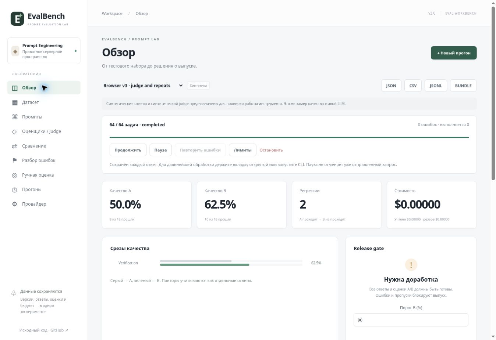

# Verification · v3

Verification is separated into deterministic fixtures, mocked provider integration, browser UI, and hosted acceptance. Real provider quality is not inferred from any synthetic result.

## Automated checks

**36/36 tests passed**, syntax checks, TypeScript and production build passed on 2026-10-22.

Run `npm test`, `npm run check`, `node node_modules/typescript/bin/tsc --noEmit`, then the maintained Sites production build. Tests use real in-memory SQLite with **all** generated migrations and the production `handleApi`; they do not replace the queue/store with a UI mock.

Coverage includes:

- Legacy rule/import/CSV/gate behavior, secure UUID fallback and original independent 8-case pipeline.
- CSV multiline/quoted fields, JSONL, scalar variables, refs/tags/rules, validation failures.
- JSON Schema/field/number/reference/RE2 grading, invalid constraints and unsafe schema references, schema-false and simultaneous prompt/case schemas.
- Structured system/few-shot/user rendering and generation parameter validation.
- Strict judge criterion parsing, weighted scores, errors and pending-judge release blocking.
- Paired comparisons, changed/missing/removed cases, evaluator mismatch, repeated measurements, bootstrap CI and human calibration.
- AES-GCM key persistence, masked API responses, upstream-only key use, endpoint-change guard and immutable versions.
- 64-task synthetic generation/judge/repetition lifecycle, persisted reload, pause/resume, reviews, regression suites, bundle round-trip and JSONL.
- Mock provider 429, invalid judge JSON and selective retries without rerunning successful generations.
- Concurrent server claims, request caps, budget reservations, unknown usage, cancel/resume and expired ambiguous calls.
- CLI as a separate Node process against the production API over real loopback HTTP: preflight, queue, artifacts, comparisons and CI exit codes.

The mock provider is a controlled fetch adapter, not a paid external LLM. Test credentials are synthetic.

## Browser QA · 2026-10-22

Managed Sites preview, actual bundled browser application and local D1:

- Saved immutable judge rubric v1; enabled judge.
- Created `Browser v3 · judge and repeats`, 8 synthetic cases, A/B, two repeats, 64 jobs. Completed 64/64, no task errors; A 50%, B 62.5%, two regressions and blocked gate.
- Opened `regress_exact`: A `OK`, B `ok`, exact-rule failure and both criterion explanations visible. Added it to regression suite v1.
- Saved human preference/comment through the review screen; blind order is deterministic per run/case.
- Compared A vs B: 8 paired cases, +12.5 percentage points; 95% case-bootstrap interval −37.5 to +62.5 pp, so UI correctly reported uncertainty.
- Imported quoted CSV through the form; inspected variables, reference, tags and rules; edited the table and saved immutable dataset versions v1/v2.
- Previewed real rendered system / user / assistant few-shot / user messages with the CSV case.

## Hosted acceptance

v2 production acceptance remains preserved: run `889ea6e5-85ca-4aa2-9db5-79f86a4ea90a`, 16 tasks, A .5 / B .625, two regressions. Persistence after one task, resume, review, CSV/JSON and archive/restore were verified on hosted D1. v2 JSON SHA256: `150325412f0c6f3bd3bf94b0c36ac9a992614273bddc5395559aeef6bbe009fe`.

v3 hosted acceptance is recorded below after deployment. No real external LLM request has been made in this workspace: a provider credential must be connected in the application's Provider screen before a real pilot can verify that provider/model.
